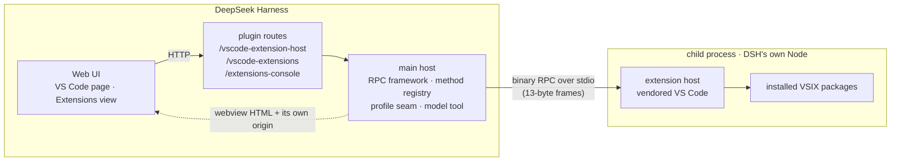

# VS Code extensions for DeepSeek Harness

**Run real VS Code extensions — the `.vsix` packages people already publish — inside DeepSeek Harness.**

DeepSeek Harness (DSH) is an agent harness with a Web UI. The VS Code ecosystem is where a large
part of the working world's tooling now lives: language servers, git clients, formatters, notebook
and diagram editors, AI coding assistants. None of that is a DSH plugin, and rewriting it would be
absurd.

This repository makes it **run as it ships**. A DSH profile installs VSIX packages from Open VSX or
the Microsoft Marketplace, and a genuine, vendored, open source VS Code **extension host** — the
same machinery VS Code itself uses — loads them in a child process. An extension that contributes a
language server, a custom editor, a tree view, a status bar item or a webview behaves the way its
author intended, because it *is* being run by the real host.

| | |
|---|---|
| **The store** | searches both registries, verifies the Open VSX signature over the whole package, unpacks into the profile, owns the publisher trust list |
| **The host** | a child process on DSH's own Node, speaking VS Code's binary RPC protocol (`PersistentProtocol` + `RPCProtocol`, 13-byte frames) |
| **The trust gate** | an extension loads only when it is **enabled** *and* its **publisher is trusted** — installed never implies loaded |
| **Crash isolation** | a crashing host restarts with a backoff; three crashes in five minutes stop the automatic restart (VS Code's own rule) |
| **The pages** | a **VS Code** tab in the right sidebar (views, tree views, status bar) and an **Extensions** view on the Plugins page |
| **The model tools** | `vscode_extension` (search / install / remove / enable / trust) and `vscode_extension_host` (status / start / stop / restart / log / command) |

One bundle, four plugin rows — see [The suite](#the-suite).

## What actually works

Not a promise list: **sixteen real packages**, each installed through this repo's own pipeline into a
running desktop profile on 2026-11-07, then measured twice — does it *activate*, and does its UI
actually *paint*.

| extension | what it is | activation | commands found | UI |
|---|---|---|---|---|
| `hediet.vscode-drawio` | custom editor for `.drawio` | active | 9/10 | **works** — the diagram opens and is editable |
| `tomoki1207.pdf` | custom editor for `.pdf` | active | — | **works** — pdf.js paints the page |
| `GrapeCity.gc-excelviewer` | custom editor for `.csv` / `.xlsx` | active | 4/4 | **works** — a sortable grid |
| `zaaack.markdown-editor` | WYSIWYG markdown editor | active | 1/1 | **works** — the editor renders the file |
| `saoudrizwan.claude-dev` (Cline) | AI coding agent | active | 17/19 | **works** — the chat UI renders in Extension views |
| `eamodio.gitlens` | git insights | active | 712/1196 | partial — the view resolves, paints nothing |
| `ms-toolsai.datawrangler` | data wrangling | active | 20/20 | partial — same |
| `qwtel.sqlite-viewer` | SQLite browser | active | 5/5 | broken — the frame loads, the grid never appears |
| `ms-vscode.hexeditor` | hex editor | **fails** | 0/8 | broken — activation dies in its telemetry setup |
| `Continue.continue` | AI chat | nominal | 34/38 | blocked — its signed native module fails code-signature validation |
| `mtxr.sqltools`, `donjayamanne.githistory`, `esbenp.prettier-vscode`, `redhat.vscode-yaml`, `bierner.markdown-mermaid`, `vscode-icons-team.vscode-icons` | no UI of their own | active | 0–35 each | — |

**Activation: 15 of 16. Commands: 991 registered.** Ten extensions present a UI of their own;
five of them actually draw. The full matrix, and the five bugs it exposed, are in
[`docs/extension-matrix.md`](./docs/extension-matrix.md). That document is the honest part of this
README: it names what is broken and why, and it is the reason the numbers here can be trusted.

## How it works



Four details decide whether a real extension survives, and each of them exists because something
concrete failed:

1. **The init payload travels as a file, not as an environment variable.** It carries every
   installed extension's *manifest*. GitLens alone is ~900 KiB (1196 commands), which crossed the
   operating system's `spawn` limit and killed the host before it existed (`spawn E2BIG`). The
   payload now goes to `<profile>/logs/exthost-init.json` and the child reads it from there.
2. **One broken extension must not take the host down.** A 2021 webpack bundle threw while its
   module was evaluated; Node exits on the unhandled rejection, so the host died and restarted in a
   loop — with sixteen extensions installed, *nothing* worked. The child now reports uncaught
   exceptions and unhandled rejections and keeps serving, the way VS Code treats "this extension
   failed" as an extension-level error.
3. **Every `MainThread*` channel is registered, and the unimplemented ones answer with a
   type-correct empty value** derived from the protocol. A blanket `undefined` crashes the host;
   a vetted stub set does not.
4. **The webview gets its own origin.** The panel and the extension's own files are served from a
   *second* loopback listener, so the iframe is cross-origin from the DSH page: its
   `localStorage` works, and it still cannot reach the application's DOM, cookies or storage. This
   is VS Code's own `vscode-webview://` model.

The host also follows the interface: the browser half reports DSH's effective colour scheme to the
extension host *before* extensions activate, so an extension that reads
`vscode.window.activeColorTheme` while it activates sees what the person sees. Without it, draw.io
paints a dark canvas on a light interface and light-on-dark shapes disappear.

## Install

```bash
git clone https://github.com/colsonSung/dsh-vscode-ext-host.git
cd dsh-vscode-ext-host
./install.sh desktop        # or: DSH_PROFILE=desktop ./install.sh
```

`install.sh` builds the extension host when its artefacts are missing, installs the bundle and its
three side packages into the profile, and adds one bundle row to
`<profile>/cordis.patch.yml`. **Restart the Harness afterwards** — the host half of a plugin is
loaded at start-up.

Manual equivalent:

```bash
dsh plugin --profile desktop add ./plugin
dsh plugin --profile desktop add ./vsix-store
dsh plugin --profile desktop add ./lsp-stdio
dsh plugin --profile desktop add ./extension-console
```

The profile then looks like this — **one** entry in `dsh.profile.bundles`, four packages in
`dependencies`:

```jsonc
"dependencies": {
  "dsh-vscode-extension-host": "link:.../dsh-vscode-ext-host/plugin",
  "dsh-vsix-store":            "link:.../dsh-vscode-ext-host/vsix-store",
  "dsh-lsp-stdio":             "link:.../dsh-vscode-ext-host/lsp-stdio",
  "dsh-extension-console":     "link:.../dsh-vscode-ext-host/extension-console"
},
"dsh": { "profile": { "bundles": ["dsh-vscode-extension-host"] } }
```

The three side packages are plain dependencies on purpose: pnpm does not install the dependencies
of a `link:` package, so carrying them inside the bundle would prune them on the next install and
their rows would fail to import.

**Requirements:** Node.js 20 or newer, the `dsh` command on `PATH`, and network access on the
first build (to fetch `esbuild`).

## Build from source

The repository ships **source, not binaries**. The extension host is 4.7 MiB (4.9 MB) of
bundled JavaScript built from the vendored VS Code closure in `vendor/` — reproducible,
reviewable, and free of any download at build time beyond `esbuild`.

```bash
npm install      # esbuild, the only build dependency
npm run build    # five steps
```

| command | produces | what it is |
|---|---|---|
| `npm run build:host` | `plugin/dist/extension-host.js` (4.7 MiB), `plugin/main-host.js` (646 KiB) | the child process (the vendored extension host) and the main side (RPC framework, profile seam, tool) |
| `npm run build:protocol` | `packages/dsh-vscode-protocol/dist/index.js` (343 KiB) | the shared ESM protocol library |
| `npm run build:client` | `plugin/client.js` | the browser half of the bundle |
| `npm run build:console` | `extension-console/client.js` | the browser half of the Extensions view |
| `npm run build:webview` | `webview-surface/client.js` | the browser half of the standalone webview bundle (superseded by `plugin/`) |

The build **never modifies a vendored file**. Every DSH-specific change lives in `runtime/**` or
`packages/**`; the upstream tree is bundled byte-identically, and the MIT notice travels with the
artefact (`plugin/vendor/LICENSE.vscode.txt`, copied in by the build).

## Using it

**Install an extension.** Open Plugins → Extensions → *Browse VSCode*, search either registry, and
install. Installing runs third-party code, so the card asks first, and the publisher then joins the
profile's trust list. The same actions are available to the model as `vscode_extension`.

**Open a file in its extension's UI.** A custom editor (`.drawio`, `.pdf`, `.csv`, `.md` …) appears
in the preview's *Open with* list under the extension's own name — "Draw.io", not a generic
"VS Code webview" — because VS Code's extensions contribute *editors*, not formats.

**Use the VS Code page.** The right sidebar has a **VS Code** tab: the webview views the loaded
extensions registered (Cline's chat, GitLens' panels), their tree views, and the status bar items
they set. Commands an extension contributes can be run from there or by the model.

**Check that it is alive.** `vscode_extension_host` with action `status` answers with the process,
the extensions and whether each one activated, the commands registered, the status bar items, and
the extensions that were skipped *and why*.

## The suite

Since 2026-11-07 these are four rows of **one** bundle. One switch on the Plugins page governs the
whole VS Code capability; the plugin manager shows one card.

| row | package | route | owns |
|---|---|---|---|
| `vsix-store` | `dsh-vsix-store` | `/vscode-extensions` | the profile's extension facts (`extensions.json`, `extensions-trust.json`), registry search, signature check, install, trust |
| `vscode-extension-host` | `dsh-vscode-extension-host` | `/vscode-extension-host` | the extension host process, the webview surface, the model tool |
| `lsp-stdio` | `dsh-lsp-stdio` | — | the `lsp` seam and one stdio language server per language, including the servers an installed extension declares |
| `extension-console` | `dsh-extension-console` | `/extensions-console` | the Extensions view on the Plugins page: one card per extension, its rows, its problems, its dependencies, plus *Browse VSCode* |

They keep their own packages and their own rows — the store must not die with the extension host,
and someone who never wants a language server still gets the store — but they no longer have four
bundle entries to switch on and off.

## Security

An installed extension is **real third-party code running with your user's permissions**. This
repository never hides that.

- **Nothing loads because it is installed.** The host reads `extensions.json` *and*
  `extensions-trust.json`; an extension is loaded only when it is enabled **and** its publisher is
  trusted. Trust is granted per publisher, deliberately, by a person.
- **The store verifies what it can verify.** An Open VSX package's Ed25519 signature is checked
  over the whole `.vsix` byte stream before it is unpacked. The Microsoft Marketplace publishes no
  signature that can be checked outside Microsoft, so a package from there rests on publisher
  verification alone — say so rather than implying otherwise.
- **A webview is isolated by origin**, not by an iframe attribute: it is served from its own
  loopback listener, so it cannot read the application's DOM, cookies or storage.
- **The extension host is a child process**, so a malicious or merely broken extension can kill the
  host — and the crash cap stops a crash loop instead of spinning.
- **No automatic installs.** The model's `vscode_extension` tool refuses to install without an
  explicit `trust: true`, which only the person can grant.

See [`SECURITY.md`](./SECURITY.md) for how to report a problem.

## Licence and attribution

Two licences apply, and they cover different trees.

| what | licence | where |
|---|---|---|
| DSH-authored code (`plugin/`, `vsix-store/`, `lsp-stdio/`, `extension-console/`, `runtime/`, `packages/`, `webview-surface/`, `spike/`) | **MIT**, © 2026 Ethan Song | [`LICENSE`](./LICENSE) |
| the vendored VS Code sources under `vendor/src/` | **MIT**, © Microsoft Corporation | [`vendor/LICENSE.vscode.txt`](./vendor/LICENSE.vscode.txt) |

The closure is the transitive import closure of the extension host entry points — **638 files,
~251,000 lines** — from `code-oss-dev` **1.144.0**, upstream commit
`1184ad4d45794110deb6b897ea83b15aac44ed89`. Every vendored file keeps its original Microsoft
copyright header, and [`vendor/ATTRIBUTION.md`](./vendor/ATTRIBUTION.md) is the authoritative
statement of what was vendored and which obligations follow.

"Visual Studio Code" and "VS Code" are **Microsoft trademarks**. This project is not affiliated
with or endorsed by Microsoft. The upstream brand fields are replaced in the DSH build
(`packages/dsh-vscode-protocol/brand.json`): the product identifies itself as "DeepSeek Harness",
the application id is `deepseek-harness`, the data folder is `.dsh` and the URL scheme is
`dsh://` — not `vscode://`. **Every file under `vendor/` is third-party code whose licence is
MIT, not this project's to relicense.**

## Repository layout

```
plugin/             the installable DSH bundle: extension host + webview surface + model tool
vsix-store/         the VSIX store: registries, signature check, install, trust
lsp-stdio/          the stdio language-server provider
extension-console/  the Extensions view on the Plugins page
runtime/            the DSH-authored host code, the build, and the executable verification suites
packages/           dsh-vscode-protocol, the shared RPC framing + channel mapping
vendor/             the vendored VS Code closure, its licence and its attribution
docs/               extension-matrix.md — the measured matrix of sixteen real extensions
spike/              the original spike: closure exporter, first bundler, stub audit
webview-surface/    the earlier standalone webview bundle (superseded by plugin/)
install.sh          one-command install of the suite into a profile
```

## Verifying it

The repository does not ask you to believe it. Everything above is checked by suites that run
against the **real** extension host, the **real** webview surface, and packages downloaded from the
registries:

```bash
npm run build
npm run verify        # host, webview, bundle smoke, client preview, view tab
```

Two suites need one third-party VSIX each, which is not committed (it is somebody else's artefact):
`runtime/verify/run.mjs` wants `spike/vendor-ext/vscode-yaml.vsix`, and
`runtime/verify/webview-e2e.mjs` wants `runtime/verify/vendor/hediet.vscode-drawio-*.vsix` —
`node runtime/verify/fetch-drawio.mjs` downloads the latter. The suites print the URL for the
former. Each suite exits non-zero on a failure and prints the assertion plus its evidence.

## Status

Working and used daily: the store, the host, custom editors, webview views, tree views, status bar,
commands, the LSP provider, the Extensions view, and 15 of 16 mainstream extensions.

Measured on macOS (darwin/arm64) with Node 22. The host is plain Node and carries no platform
specific code of its own, but the numbers above are macOS numbers, and the extensions in the
matrix are the ones that were run.

Known limits, stated rather than hidden: Continue's chat view is blocked by macOS code-signature
validation of its native SQLite module; `ms-vscode.hexeditor` still fails to activate; the SQLite
viewer's worker/wasm pair is not served; GitLens' and Data Wrangler's views resolve but paint
nothing. The full list with causes is in [`docs/extension-matrix.md`](./docs/extension-matrix.md).

The host answers **every** `MainThread*` channel, but the ones it implements for real are the ones
the measured extensions needed. An extension that reaches into an unimplemented capability gets a
type-correct empty answer, not a crash — which means "it activated" is a weaker claim than "it
works completely". See [`runtime/verify/README.md`](./runtime/verify/README.md) for what each
suite proves.
